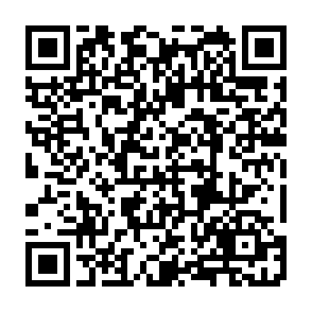

# SHIELD MP4 Player

Lecteur de vidéos MP4 **locales** pour 3DS, pensé pour Old 3DS. Il parcourt la carte SD, affiche la vidéo sur l'écran supérieur et propose lecture/pause, sauts de cinq secondes et luminosité. Il n'utilise pas le réseau.

**Provenance des binaires :** les archives FFmpeg historiques ne sont pas redistribuées dans ce dépôt ; leur correspondance avec les sources et les options du CIA publié reste à établir. Voir [le relevé commun des dépendances](https://github.com/Shield-77/Shield-MP3-downloader/blob/main/LICENSING_STATUS.md) et [les notices tierces](THIRD_PARTY_NOTICES.md).

## Télécharger / Download

**[MP4Player-Old3DS-v32.cia (v1.1.11)](https://github.com/Shield-77/Shield-MP4-Player/releases/download/v1.1.11/MP4Player-Old3DS-v32.cia)** · [Toutes les releases](https://github.com/Shield-77/Shield-MP4-Player/releases)

Sur une 3DS modifiée, ouvrir FBI > Remote Install > Scan QR Code.

## Version actuelle et compatibilité

La dernière release est **[v1.1.11](https://github.com/Shield-77/Shield-MP4-Player/releases/tag/v1.1.11)** ; son fichier est `MP4Player-Old3DS-v32.cia`. La v1.1.11 rétablit le fonctionnement normal du bouton POWER et de la veille, ajoute la confirmation de langue français/anglais au premier lancement et traduit l'interface. Maintenir **X** pendant le splash permet de revoir le choix de langue. **HOME reste désactivé dans l'application ; START permet de quitter.**

La sortie vidéo reste limitée à **256 × 144 pixels**. Certains MP4 plus grands ou avec des codecs non compatibles sont refusés avec un code d'erreur, pour éviter de dépasser la mémoire disponible sur Old 3DS. Le lecteur ne rend pas une source 144p plus détaillée que son fichier d'origine.

## Préparer vos vidéos

Le lecteur fonctionne hors ligne. Utilisez des fichiers MP4 compatibles avec sa limite de résolution ; [SHIELD Optimised Converter](https://github.com/Shield-77/Shield-Optimised-MP4-Converter-) peut préparer certains fichiers directement sur 3DS.

## Commandes

- **Haut/Bas** choisit un fichier dans l'explorateur. **A** ouvre ou met en pause/reprend ; **B** revient ou arrête.
- **Gauche/Droite** recule ou avance de cinq secondes pendant la lecture.
- **Haut/Bas** règle la luminosité pendant la lecture. **SELECT** affiche le panneau de diagnostic.
- **START** quitte. Le tactile et le Circle Pad ne commandent pas le lecteur.

Un guide apparaît après le choix de langue au premier lancement. La lecture de différents fichiers dépend aussi de leurs codecs et de leur résolution ; commencer par une vidéo courte en cas de doute.

## Source et licences

Le code de la v1.1.11 est dans [`source/`](source/) ; `source/main.cpp` a été rapproché du dossier local dont le CIA correspond octet pour octet à la release publique (SHA-256). Le Makefile, les visuels et le RomFS sont présents. Pour compiler, installer devkitPro/devkitARM et fournir une version 3DS de **FFmpeg** avec ses en-têtes et bibliothèques via `FFMPEG_ROOT`. Obtenir `makerom` et `bannertool` séparément (`MAKEROM`, `BANNERTOOL`). Les bibliothèques FFmpeg précompilées de l'ancien environnement ne sont pas redistribuées ici, car leur configuration et leur code source exact doivent être documentés. Le CIA publié n'est donc pas reproductible avec ce dépôt seul. La bannière du source public utilise un son silencieux ; le CIA de la release reste inchangé.

Le code propre à SHIELD MP4 Player est sous [GPLv3](LICENSE). Le code adapté de FourthTube garde ses mentions et droits d'origine ; FFmpeg conserve sa licence propre, qui dépend des options de compilation. Voir [THIRD_PARTY_NOTICES.md](THIRD_PARTY_NOTICES.md) et [la page officielle FFmpeg](https://ffmpeg.org/legal.html). Les logos et le nom SHIELD restent l'identité du projet. Le code a été généré avec l'aide de Codex ; Shield-77 conçoit les fonctions et teste sur console.

## Développement

Le code a été généré avec l'aide d'OpenAI Codex, un assistant de programmation par IA. SHIELD-77 conçoit les fonctionnalités et teste les applications sur console.
